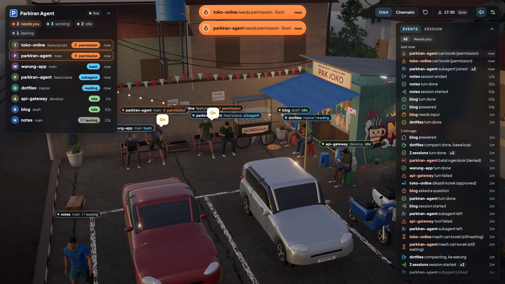
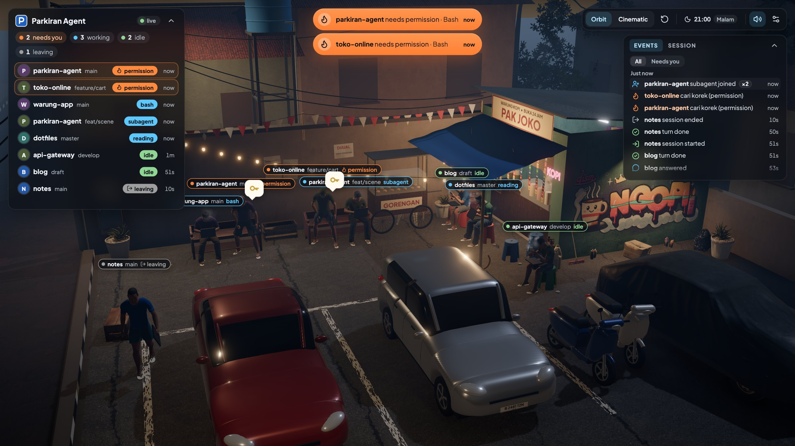
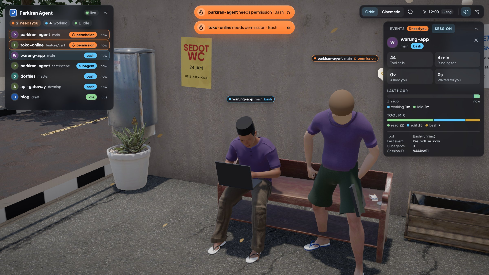
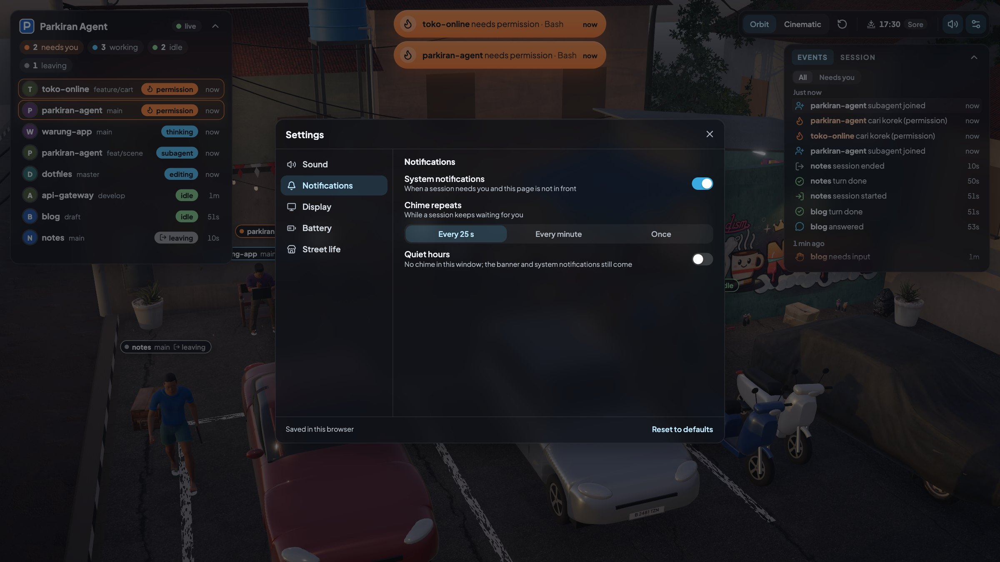

# Parkiran Agent

A small 3D parking lot beside a warung kopi, live in your browser. Every running Claude Code session (the desktop app's
Code tab or the CLI) is a person who walks in, sits down and works on a laptop, mirroring the real session: typing while
tools run, standing up for a lighter when Claude needs your permission, a kopi run during compaction, dozing when idle,
walking away when the session ends.



<p>
  
  
  
</p>

```
Claude Code hooks ──stdin JSON──▶ relay (Bun) ──HTTP POST──▶ server (Bun, 127.0.0.1) ──WebSocket──▶ web (Vite + R3F)
```

Everything runs on your machine; the relay forwards only a few ids and names (see [Privacy](#privacy)).

## Quick start

Needs macOS (tested on Apple Silicon), [Bun](https://bun.sh) 1.4 or newer, a WebGL2 browser (Chrome, Safari, Firefox)
and Claude Code (the desktop app's Code tab or the `claude` CLI).

```bash
git clone https://github.com/dickymahfudin/parkiran-agent.git
cd parkiran-agent
bun install                  # packages, and the 3D assets unpacked into web/public/assets
bun run install-hooks        # shows the exact ~/.claude/settings.json diff and asks before writing
bun run web:build            # builds the web app into web/dist
bun run server               # then open http://127.0.0.1:4747
```

Running sessions appear on their next hook event (send a prompt); Claude Code picks up the new hooks without a restart.
`install-hooks` also creates `.env` with a random token and pins the path of your `bun`, so run it again after switching
Bun versions. `bun run doctor` checks the whole setup.

## What you see

| Session | Character |
|---|---|
| Starts | walks in from the street and takes a free seat; waves at the neighbours |
| Thinking, running tools | types and smokes; faster for Bash, slower for reading |
| Needs permission | stands up looking for a lighter; gets a light when you approve |
| Asks a question | stands up with a "?" bubble |
| Turn done | stretches; a check badge and a soft "ting" |
| Tool or turn failed | facepalm, then back to work |
| Compacting | walks to the warung for a kopi |
| Subagent | a friend walks in and sits nearby |
| Idle | shuts the laptop and scrolls the phone; dozes off after 30 min |
| Ends | closes the laptop and walks away |

Around them, Pak Joko keeps the warung, a bakso or nasi goreng cart calls in the evening, cars and ojek pass by, and
the sun and moon follow your clock.

- **HUD:** the session list (what needs you first), a needs-you banner, and an inspector with a grouped event feed and a
  session view (its last hour, tool mix, how long it waited for you). Keys: `R` reset view, `Esc` close, `,` settings,
  `?` all keys.
- **Notifications:** a chime and a system notification when a session needs you; clicking the character silences the
  chime.
- **Camera:** drag to orbit, scroll to zoom, click someone to follow; **Cinematic** goes where things happen.
- **Battery:** Saver by default: 20 fps at most, light rendering, nothing at all in a hidden tab.
- **Settings** (gear or `,`): sound, notifications, quiet hours, display, battery and street life, saved per browser.

Everything in detail: [docs/GUIDE.md](docs/GUIDE.md).

## Privacy

The relay builds each outgoing message from an allowlist: event name, session id, project name (git repository name, or
the folder name), branch, tool name, notification type, subagent id and type, tool-use id, a few closed enums (session
start source, end reason, compaction trigger, failure kind) and timestamps.

Never forwarded or stored: tool inputs and outputs, prompts, file contents, commands, messages, transcripts and full
paths. The server binds to 127.0.0.1, checks the token, the `Host` header and the WebSocket `Origin`, and makes no
outbound requests. Nothing reads Claude credentials, OAuth tokens or the Keychain. The optional raw debug log records
only the shape of events (keys, types, lengths), never values.

## Configuration

`install-hooks` writes `.env` (mode 600, gitignored); every other key is optional. See [.env.example](.env.example).

| Key | Default | Meaning |
|---|---|---|
| `PARKIRAN_TOKEN` | random | shared secret between relay and server (written by `install-hooks`) |
| `PARKIRAN_PORT` | `4747` | server port (127.0.0.1 only) |
| `PARKIRAN_GIT` | written by `install-hooks` | absolute path of `git`, used only for repositories in the reftable format; unset, their branch stays empty |
| `PARKIRAN_WEB_PORT` | `4748` | Vite dev server port |
| `PARKIRAN_LAT`, `PARKIRAN_LON` | `-6.2`, `106.8` | where the lot is, for the sun (Jakarta); the clock always reads your local time |
| `PARKIRAN_IDLE_MINUTES` | `30` | idle time before a character dozes off |
| `PARKIRAN_REAP_HOURS` | `12` | sessions without events leave after this |
| `PARKIRAN_ALLOWED_ORIGINS` | – | extra WebSocket origins, comma separated |
| `PARKIRAN_STATIC_DIR` | `web/dist` | what the server serves at `/` |
| `PARKIRAN_RELAY_DEBUG`, `PARKIRAN_RELAY_RAW` | `0` | relay error log / shape-only raw event log in `logs/` |

## Uninstall

```bash
bun run uninstall-hooks      # shows the diff, asks, removes only Parkiran's handlers
```

`settings.json` ends up byte for byte as it was before `install-hooks`, and a backup is kept in `.parkiran/` before every
write. If the file is not in standard JSON formatting, install refuses unless you pass `--allow-reformat`. Details:
[docs/GUIDE.md](docs/GUIDE.md#install-and-uninstall-in-detail).

## Troubleshooting

- **Not sure what is wrong:** `bun run doctor` checks `settings.json`, the pinned bun and relay paths, `.env`, the install
  manifest, the server (`/api/health`) and the web build, one `ok` / `warn` / `fail` line each.
- **Nobody shows up:** check the HUD shows *live*; send a prompt in Claude (sessions appear on their next event);
  `PARKIRAN_RELAY_DEBUG=1` in `.env` writes relay errors to `logs/`.
- **"asset failed to load" in the HUD:** run `bun install` again (re-extracts the archive).
- **Hooks stopped after a Bun upgrade:** run `bun run install-hooks` again (the hook pins the bun binary path).
- **No notifications:** allow notifications for 127.0.0.1 in the browser, then turn on **System notifications** in the
  settings.

## Development

```bash
bun run web                                       # Vite dev server on http://127.0.0.1:4748 (hot reload)
bun run simulate -- --port=4757 --scenario=tour   # scripted sessions against a test server, no Claude needed
bun test && bun run typecheck && bun run lint
```

The simulator, the test server and CI: [docs/GUIDE.md](docs/GUIDE.md#development).

## Docs

- [docs/GUIDE.md](docs/GUIDE.md): everything the lot does, settings, development, assets
- [docs/ARCHITECTURE.md](docs/ARCHITECTURE.md): how it works
- [docs/EXPERIMENTS.md](docs/EXPERIMENTS.md): what Claude Code hooks really send
- [docs/ROADMAP.md](docs/ROADMAP.md): what could come next
- [CHANGELOG.md](CHANGELOG.md) and [CREDITS.md](CREDITS.md) (asset sources and licences)

## License

MIT
