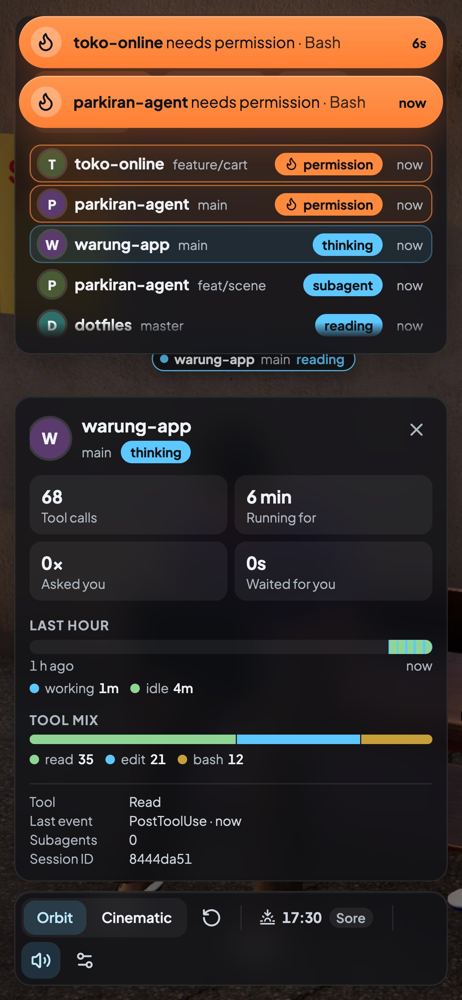

# Guide

Everything the lot does, in detail. The short version is in the [README](../README.md); how it works inside is in
[ARCHITECTURE.md](ARCHITECTURE.md).

## The people

| Session | Character |
|---|---|
| Session starts | walks in from the street along the gang, straight to a bench, stool or car hood, opens the laptop; waves at whoever sits next to it (they wave back) |
| `thinking` | types with one hand, smokes with the other; when the tools start, the cigarette goes to the lips |
| Working (`reading`, `bash`, `editing`, `browsing`, `subagent`) | types; slower for reading, faster for Bash |
| Needs permission (`permission`) | stands up with an unlit cigarette, pats pockets, looks around; lighter bubble |
| Permission approved | gets a light, first drag, sits back down |
| Permission denied (inferred, Claude sends no event) | sighs, pockets the cigarette, sits back down |
| Question / input (`question`, `needs input`) | stands up with a "?" bubble |
| Turn done | leans back for a stretch, a check badge pops up over the head, a soft "ting" |
| Turn ended unseen (Esc, a crash or a closed lid fire no hook) | after 15 min without an event, no tool running and no friend out, goes idle quietly (no ting); the quiet minutes never count as work |
| `idle` | shuts the laptop, lights a cigarette and scrolls the phone, with the odd drag; two idle neighbours now and then turn to each other for a chat |
| Tool or turn failure (`error`) | facepalm, then back to work |
| `compacting` | buys a kopi at the warung window, drinks it on a free warung stool (or back on its own seat) with the kopi in one hand and the kretek or vape in the other, walks back when done |
| Subagent | a friend walks in and sits next to the parent (or on any free seat), leaves when done |
| Idle for 30 min (`dozing`) | laptop shut, dozes off, Zzz |
| Session ends (`leaving`) | stubs out the cigarette, closes the laptop, walks away |

Not everyone smokes kretek: about 70 % do, a quarter vape (the pod held upright in a closed fist, brought to the lips;
no lighter; the LED glows on a pull and they blow thick white clouds) and 5 % do not smoke at all (they type while
thinking and sip a kopi over the phone when idle). The table above is the kretek smoker's version; a vaper or a
non-smoker asked for permission gets a key bubble instead of the lighter and sits back down without lighting up.

About one person in ten wears a black peci and three in ten glasses, picked per session (a cap, one in five, never goes
over a peci). By each seat a tin ashtray fills up with butts as the session ages (one per 15 minutes) and an empty kopi
glass stays behind after every compaction, so you can tell an old session from a new one without the HUD.

When every seat is taken, newcomers and friends stand at their own spot (clear of the sitters, the cars and the walking
lanes, never inside each other) and sit down as soon as a seat frees up.

## The lot

**Pak Joko** keeps the warung: behind his counter he smokes, sips, scrolls his phone and looks around, hands the kopi
over when someone comes to buy, and naps on his stool from 23:00 to 04:30.

**Food carts:** from 17:00 to 01:00 a bakso or nasi goreng vendor calls at the lot every 5 minutes. He pushes the cart in
along the footpath, stops by the lot's west edge for 45 s with his "ting-ting" or "tek-tek", backs out to the mouth of
the gang, turns round and leaves (off, evenings or all day in the settings).

**Around it:** the scene follows your local clock. The sun and moon are computed from latitude and longitude, lamps and
the warung light up at dusk, and moths circle the street lamp at night. Cars and ojek riders pass by single file with a
safe gap, and a kucing oren naps around the lot. The warung's side wall carries a spray-painted "NGOPI dulu!" piece with
a kopi cup and its kretek, a korek gas and the writer's "dism" tag, under a tin-shade lamp that lights it at night; warm
festoon bulbs hang from the awning over the benches and red-white bunting runs along the back wall.

## Camera

The default view is framed on the benches, the gerobak and the warung. Drag to orbit; scroll to zoom towards whatever is
under the mouse, right up to a person's face (scrolling back out returns to the overview); click a character to follow
it. **Reset view** in the toolbar, the `R` key or a double-click on empty ground brings back the default angle.

**Cinematic** is a director: it goes where things happen (a close-up of whoever needs you, a medium shot of a finished
turn or a failure, following a newcomer or a coffee run), holds every shot at least 6 s, and drifts over the lot in
between, now and then visiting someone at work.

## HUD

**Session list:** each character's shirt colour next to the project, a summary of how many sessions need you, work or
idle, and the tool and age of every session (MCP tools read as "Claude Browser › javascript_tool"; sessions of the same
project and branch are told apart as `#2`, `#3`). Sessions waiting on you sit at the top; from six sessions on each one
takes a single line, the panel stops at 58 % of the window and scrolls, the summary chips filter the list by state, and
the fold button tucks it away down to the summary (remembered per browser).

**Inspector** (right), with two tabs:

- **Events:** grouped by age ("Just now", "3 min ago", "Earlier"), runs of the same event merged into one line with a
  count ("4 sessions turn done ×4"; what needs you or went wrong is never merged), an "All / Needs you" filter, and
  milestones (100 tool calls, 1 h of work, the 2nd compaction).
- **Session:** click a row, a character or the banner and it opens on that session, with four tiles (tool calls, running
  for, asked you, waited for you), its last hour as a strip, its tool mix and the small facts below. `Esc` or the close
  button goes back to the events and the camera lets go.

The inspector is as tall as its content and folds to its header (remembered per browser; folded, it counts what needed
you since). Sessions waiting on you also appear as a banner at the top until they are handled.

**Toolbar:** orbit / cinematic and reset view, the time of day, the sound mute and the settings. **Keys:** `R` resets the
view, `Esc` closes or lets go, `,` opens the settings, `?` lists the keys.

**Phone:** a selected session opens as a sheet at the bottom, and what needs you then moves to the top.



States and events use stroke icons (Lucide), no emoji. Plain facts read in English; the warung jokes stay ("cari
korek", "batal ngerokok", "bawa kopi").

## Notifications

When a session needs you, a chime plays (and repeats every 25 s); when the page is not focused you also get a system
notification such as "warung-app needs permission" with the branch, which disappears as soon as the session is handled.
System notifications are on by default (the browser asks for permission on your first click) and can be turned off in
the settings. Clicking the character silences the chime; it never changes the real session. Sound starts after your
first click on the page (a browser rule).

## Settings

The gear in the toolbar or `,` opens them: a dialog with the categories on the left, or a sheet with a category list on
a phone. They are saved per browser; `Esc` or a click outside closes the dialog.

| Group | Setting | Default |
|---|---|---|
| Sound | All sounds (also the toolbar's speaker); volume (let go of the slider to hear the chime); one by one: needs-you chime, turn-done ting, lighter, food carts | on; 100 %; all on |
| Notifications | System notifications when the page is not in front; chime repeats every 25 s / every minute / once; quiet hours (no chime in a window you pick, the banner and system notifications still come) | on; 25 s; off (22:00–07:00 when on) |
| Display | Compact mode for a second monitor (`?compact` still forces it); name tags off / name / full (need bubbles always show); smoking: mixed / nobody / vapes only (Pak Joko and the ashtrays too); start in cinematic; the event feed's starting filter | off; full; mixed; off; All |
| Battery | Saver (20 fps at most, always light) / Balanced (60 moving, 30 watching, 15 behind) / Smooth (60 nearly always) | Saver |
| Street life | Food carts: off / evenings (17:00–01:00) / all day; traffic (cars and ojek) on or off | evenings; on |

In dev mode (`bun run web`) a Developer category holds a free scene time.

**URL options:** `?time=21:00` (fixed scene time), `?compact`, `?cinematic`, `?stats` (frame-rate meter); in dev mode
also `?cam=px,py,pz,tx,ty,tz`, `?cart=bakso|nasgor` (a cart right now) and `?gallery`.

## Time of day

The scene clock in the toolbar is also a menu: **Auto** follows your clock, **Pagi** (07:00), **Siang** (12:00), **Sore**
(17:30) and **Malam** (21:00) hold the lot at that time. Switching eases the sun round the clock in 1.5 s; the choice is
remembered in this browser (`?time=` still wins). The lot's clock always reads your local time; `PARKIRAN_LAT` and
`PARKIRAN_LON` only place the sun.

## Performance and battery

By default (Saver) the lot renders at most 20 fps, 15 when it is quiet and 10 with another window in front, always light
(resolution 1, no ambient occlusion), and nothing at all in a hidden tab. Balanced gives 60 fps while the view moves
(evenly paced on 120 Hz screens), 30 while you watch sessions work, 20 on a quiet lot and 15 behind other windows, and
renders light only after 3 s in the background. Resolution drops in three steps (1.5 → 1.25 → 1) when frames run slow,
and every shader is compiled up front so props never stall a frame when they first appear. About 570 draw calls and 650k
triangles a frame with six people in the lot.

## Sound

Procedural cues, no audio files: the chime when a session needs you, a soft "ting" when a turn is done, the lighter, and
the food carts' "ting-ting" / "tek-tek" as they pass. There is no background ambience: between cues the audio context
sleeps, so it costs no battery and does not keep the Mac awake.

## Install and uninstall in detail

`bun run install-hooks` adds one async hook per Claude Code event to `~/.claude/settings.json`, pointing at
`relay/src/index.ts` with the absolute path of your current `bun` binary (switching Bun versions with asdf or Homebrew
needs another `install-hooks`). It also creates `.env` (mode 600) with a random 256-bit token, the port and the absolute
path of `git`.

Before every write or delete, the current `settings.json` is copied to `.parkiran/settings.json.<timestamp>.bak` (mode
600, the last 10 kept). `uninstall-hooks` removes only Parkiran's handlers and leaves the file byte for byte as it was
before `install-hooks` (containers the installer created are removed too; the manifest is in
`.parkiran/hooks-install.json`). If the file is not in standard JSON formatting, install refuses unless you pass
`--allow-reformat`. Both scripts accept `--dry-run` and `--settings=<path>`.

## Development

```bash
bun run server               # API + WebSocket on 127.0.0.1:4747 (server:dev restarts on changes)
bun run web                  # Vite dev server on http://127.0.0.1:4748 (hot reload)
bun run simulate -- --list                        # scripted sessions, no Claude needed
bun run simulate -- --port=4757 --scenario=tour   # against a test server: PARKIRAN_PORT=4757 bun run server
bun scripts/watch.ts --seconds=120                # prints live state changes and the HUD states seen
bun test && bun run typecheck && bun run lint     # lint = Biome (biome.json); `bun run lint:fix` applies the safe fixes
```

Simulator scenarios: `working`, `approve`, `deny`, `question`, `failure`, `compact`, `subagent`, `idle`, `end`, `six`
(six busy sessions), `tour` (every state at once). Options: `--speed=2`, `--loop`, `--fresh`. `--port=` (or
`PARKIRAN_SIM_PORT`) is required, and the simulator refuses the port in `.env` (your live lot, where fake sessions would
sit for hours next to the real ones) unless you pass `--live`. Doze needs a short idle time on the test server:
`PARKIRAN_IDLE_MINUTES=0.3`.

The install scripts read `PARKIRAN_ENV_FILE` and `PARKIRAN_MANIFEST_FILE` instead of `.env` and
`.parkiran/hooks-install.json` when set (the tests use them).

CI (`.github/workflows/ci.yml`) runs install, lint, typecheck, tests and the web build on every push to `main` and every
pull request, with the Bun version from `.tool-versions`.

## Assets

The optimised models, textures, skies and the animated character are committed as one archive
(`assets/parkiran-assets.tar.gz`, checksums in `assets/parkiran-assets.json`) and extracted on `bun install`. To rebuild
them from their sources:

```bash
bun run assets               # Poly Haven models, textures and skies (downloads, then repacks the archive)
bun run assets:character     # MakeHuman/MPFB character + Quaternius/keyframed clips in Blender 5.2 (BLENDER=/path)
```

Sources and licences: [CREDITS.md](../CREDITS.md).

## Layout

```
shared/   event schema + validators, session reducer, seats, sun position (used by server, simulator, tests)
relay/    hook entrypoint: stdin → allowlist → POST, ~14 ms per run, never blocks Claude (async hooks)
server/   Bun.serve: POST /ingest, WebSocket /ws, static web/dist
web/      Vite + React Three Fiber scene, HUD, audio, notifications
scripts/  install/uninstall hooks, simulator, doctor, asset pipeline, Blender scripts
assets/   asset archive (+ raw downloads and Blender output, gitignored)
docs/     this guide, architecture, Claude Code experiments, roadmap, screenshots
```
